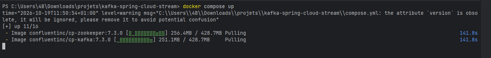
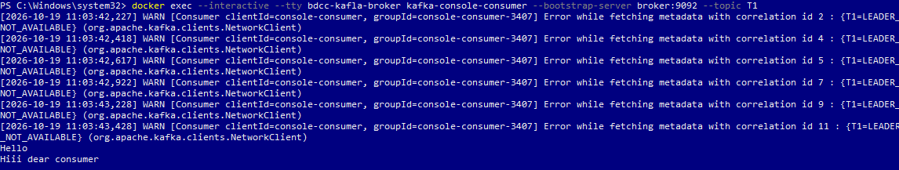
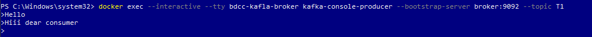
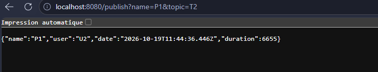
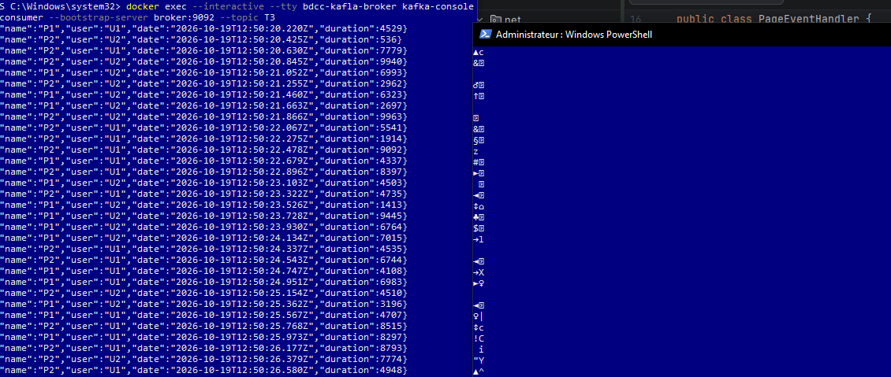

Telechargement via docker

Test (creation producer/consumer) :

Le producer : 

Le consumer : 

Nouveau consumer qui peut consommer des le debut : 

Creation d'un producer avec topic T2 via le controller

kafka-Console-Consumer:

Consumer au niveau de Spring

-> ON fait refresh le navigateur (comme ci dessus)

Test avec un Supplier 

Kafka Stream Processing :

